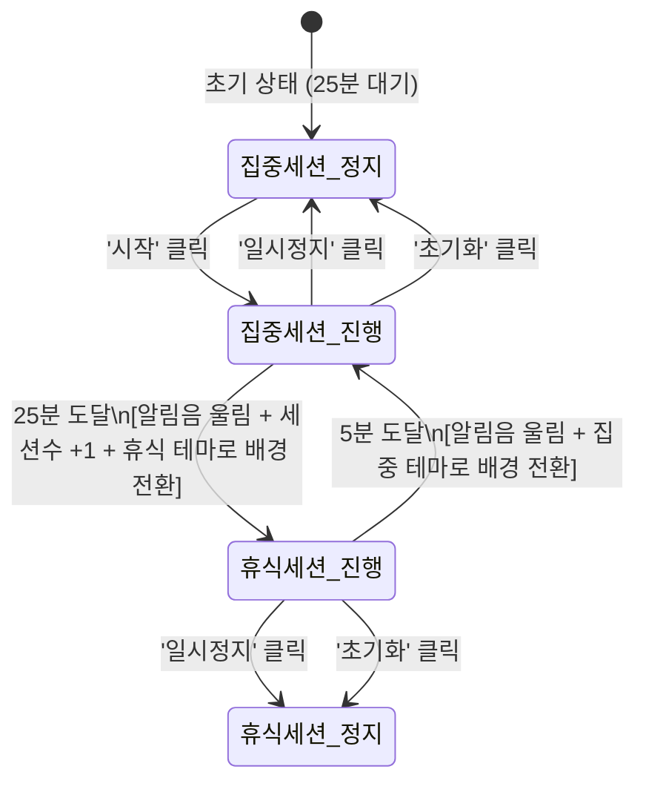

# 🍅 포모도로 타이머 웹 애플리케이션 프로젝트 개요 및 기능명세서 (PROJECT_SPECIFICATION.MD)

---

## 1. 프로젝트 개요 (Overview)
- **프로젝트명**: FocusFlow Pomodoro (포모도로 타이머)
- **목적**: 25분 집중과 5분 휴식 주기를 효율적으로 관리하고, 시각적 피드백과 편안한 백색소음을 통해 사용자의 몰입도와 작업 생산성을 극대화하는 웹 애플리케이션
- **기술 스택**: 
  - **구조**: Semantic HTML5
  - **스타일링**: Vanilla CSS3 (현대적 글래스모피즘, 다이내믹 컬러 테마 및 부드러운 애니메이션)
  - **동작 로직**: Vanilla JavaScript (ES6+, Web Audio API 및 HTML5 Audio 연동)

---

## 2. 화면 및 디자인 컨셉 (Design & Theme)
- **레이아웃**: 
  - 화면 중앙에 대형 원형 진행 링(SVG Circular Progress Ring) 및 굵직한 디지털 카운트다운 타이머 배치
  - 하단에 직관적인 타이머 제어 버튼(시작 / 일시정지 / 초기화)과 세션 카운터 배치
  - 우측 상단/사이드에 컴팩트한 백색소음 사운드 믹서 패널 배치
- **동적 배경 테마 (상태별 색상 전환)**:
  - **집중 세션 (Focus Mode)**: 차분하고 집중력을 높여주는 딥 인디고 / 블루-바이올렛 그라데이션
  - **휴식 세션 (Break Mode)**: 눈의 피로를 풀어주고 이완을 돕는 따뜻한 세이지 그린 / 에메랄드 틸 그라데이션
  - 모드 전환 시 CSS `transition`을 통해 배경색과 UI 액센트 색상이 1~1.5초간 부드럽게 크로스페이드
- **UI 스타일 및 인터랙션**:
  - 버튼: 둥근 모서리(Pill/Rounded Shape) 적용
  - 마우스 호버(Hover) 시 부드러운 스케일 업(`transform: scale(1.05)`), 부드러운 그림자(Glow) 효과 적용

---

## 3. 상세 기능 명세서 (Functional Specification)

### 3.1. 타이머 엔진 및 자동 세션 전환
1. **세션 주기**:
   - **집중 시간**: `25분 00초` (1,500초)
   - **휴식 시간**: `5분 00초` (300초)
2. **자동 전환 시스템**:
   - 25분 집중 카운트다운이 `00:00`에 도달하면 즉시 완료 알림음이 울리고, 세션 카운트가 1 증가한 뒤 자동으로 **5분 휴식 모드**로 전환되어 타이머가 연속 진행됨
   - 5분 휴식 카운트다운이 `00:00`에 도달하면 알림음과 함께 자동으로 **25분 집중 모드**로 복귀하여 다음 사이클 시작
3. **타이머 컨트롤**:
   - **시작 (Start)**: 1초 단위로 시간 감소 시작
   - **일시정지 (Pause)**: 남은 시간 상태를 유지하며 즉시 멈춤
   - **초기화 (Reset)**: 현재 활성화된 모드(집중 25분 또는 휴식 5분)의 초기 시간으로 리셋

---

### 3.2. 시각적 피드백 및 디스플레이
1. **대형 카운트다운 텍스트**:
   - 화면 중앙에 `MM:SS` 형태로 명확하고 가독성 높은 디지털 폰트로 실시간 표시
2. **원형 진행 링 (Circular Progress Ring)**:
   - SVG `stroke-dasharray`와 `stroke-dashoffset`을 이용한 고해상도 벡터 원형 게이지
   - 경과 시간에 따라 100%에서 0%로 줄어들거나 진행률에 맞게 부드러운 애니메이션으로 채워짐
   - 집중 모드와 휴식 모드에 맞춰 게이지 테두리 색상 동적 변경
3. **브라우저 탭 제목(Title) 실시간 동기화**:
   - 다른 탭이나 프로그램을 사용 중이어도 확인할 수 있도록 브라우저 타이틀에 잔여 시간 및 현재 상태 실시간 표기
   - 예시: `(24:35) 🍅 집중 중 | FocusFlow`, `(04:12) ☕ 휴식 중 | FocusFlow`

---

### 3.3. 사운드 시스템 (백색소음 & 알림음)
1. **완료 알림음 (Alarm Sound)**:
   - 25분 집중 종료 시 및 5분 휴식 종료 시 브라우저에서 명확하고 기분 좋은 완료음 자동 재생
   - 오픈소스/Royalty-free 사운드 또는 Web Audio API 기반 오디오 톤 생성 활용
2. **앰비언트 백색소음 (White Noise Mixer)**:
   - **지원 음원**:
     - 🌊 파도 소리 (Ocean Waves)
     - 🌧️ 빗소리 (Gentle Rain)
     - 🐦 숲속 새소리 (Forest Birds)
   - **제어 기능**:
     - 사운드 선택(토글) 기능
     - 0% ~ 100% 미세 볼륨 조절 슬라이더
     - 원클릭 음소거(Mute) / 음소거 해제 토글 버튼 (아이콘 시각 변경)

---

### 3.4. 세션 카운터 (Session Counter)
1. **완료 기록**:
   - 25분 집중 세션을 온전히 완료할 때마다 세션 카운트가 1회씩 누적 표시 (예: `완료한 집중 세션: 🍅 x 3`)
2. **데이터 지속성 (Persistence)**:
   - 브라우저의 `localStorage`를 연동하여 페이지를 새로고침하거나 브라우저를 닫았다 열어도 당일 완료한 세션 수가 유지되도록 구현
   - 필요 시 카운트를 0으로 되돌릴 수 있는 리셋 옵션 제공

---

## 4. 사용자 상태 전이 다이어그램 (State Diagram)

---

## 5. 단계별 구현 계획
1. **1단계**: 프로젝트 기본 구조(`index.html`, `style.css`, `app.js`) 및 모드별 컬러 변수/글래스모피즘 스타일링
2. **2단계**: SVG 원형 프로그레스 링 및 정밀 1초 타이머 엔진, 브라우저 탭 실시간 동기화 구현
3. **3단계**: 백색소음 3종(파도, 비, 새소리) 오디오 스트림, 볼륨 슬라이더 및 음소거 UI 구현
4. **4단계**: 세션 완료 알림음 연동, 모드 자동 전환 로직, 세션 카운터 및 로컬스토리지 저장 연동
5. **5단계**: 버튼 호버 애니메이션, 반응형 레이아웃 및 최종 인터랙션 검증
